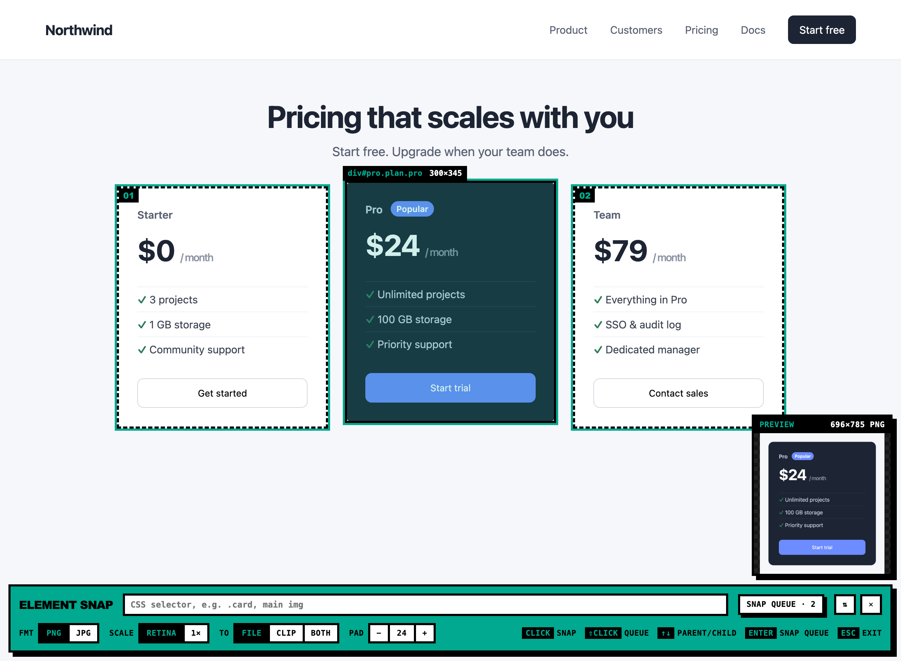
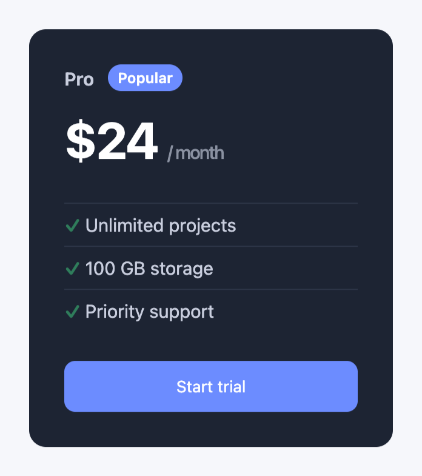
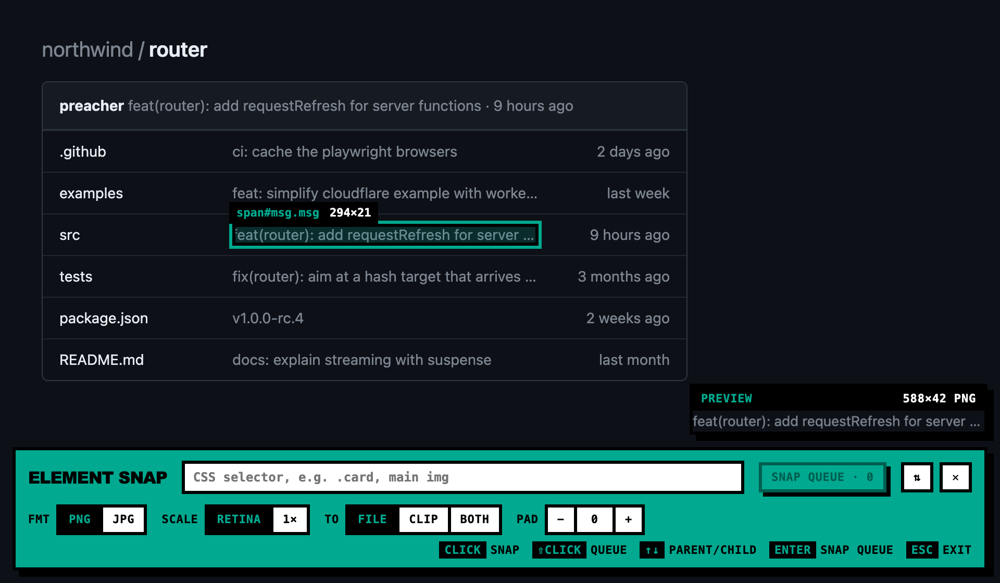
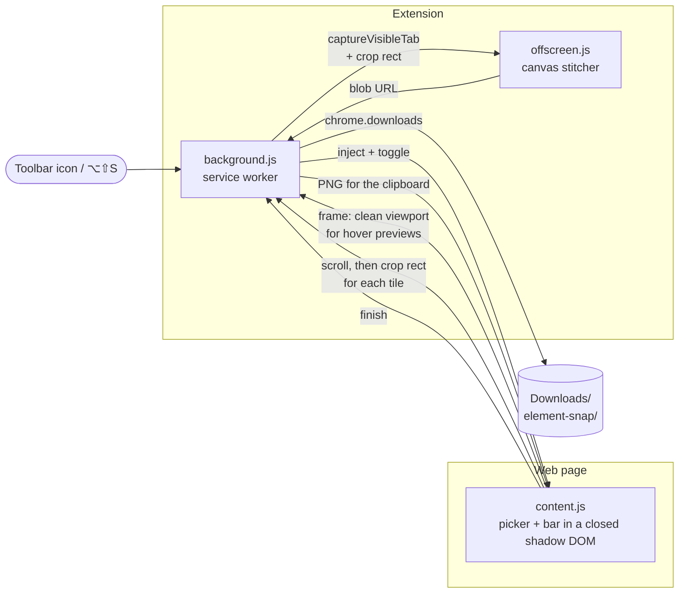

# Element Snap

A Chrome extension that saves any element on a web page as a pixel-exact image.

Click the toolbar icon and the picker starts right away. Hover to highlight an element and see a live preview of the image you'll get, then click to save it. Queue several and save them in one go, or type a CSS selector to grab every match. Elements taller than the screen are scrolled through and stitched into one image.

<p align="center"></p>

<p align="center"><br><sub>What lands in your Downloads folder: just the element, at retina resolution.</sub></p>

## Requirements

- Chrome 116 or later, or another Chromium browser (Edge, Brave, Arc)

## Install

```sh
git clone https://github.com/preacherxp/element-snap.git
```

1. Open `chrome://extensions` and turn on **Developer mode**
2. Click **Load unpacked** and pick the `element-snap` folder
3. Pin **Element Snap** to the toolbar

To update, `git pull` and click the reload button on the extension's card in `chrome://extensions`. To uninstall, click **Remove** there.

## Usage

Click the toolbar icon, or press `⌥⇧S` (`Alt+Shift+S` on Windows and Linux). Click the icon again to close the picker.

| Key | Action |
| --- | --- |
| Click | Save the highlighted element |
| Shift+Click / Space | Add it to the queue, or take it out |
| ↑ / ↓ | Go to the parent element / back to the child |
| Enter | Save the queue (or the highlighted element if the queue is empty) |
| Esc | Close the picker |

While you hover, a **preview** card next to the bar shows the element cropped as it will be saved, with your padding, plus the output size in pixels. It updates as soon as you change the format, scale or padding. It notes when an element is bigger than the screen (it gets stitched) or partly off screen (it gets scrolled into view). The preview steps aside if it would cover the element you're pointing at.

<p align="center"></p>

The bar at the bottom of the page holds the rest:

- **Selector field.** Type a CSS selector and every visible match joins the queue. Enter or **SNAP QUEUE** saves them all.
- **FMT** PNG or JPG. **SCALE** retina (your screen's pixel density) or 1×. **TO** file, clipboard or both. **PAD** space around the element. Settings are remembered.
- **⇅** moves the bar to the top or bottom of the page. **✕** closes it.

Images are saved to `Downloads/element-snap/` as `host_tag-id_timestamp.png`, without a Save As dialog.

If the shortcut doesn't respond, set it at `chrome://extensions/shortcuts`.

## Architecture



- **`content.js`** is injected when you click the icon. It draws the highlight, labels, queue marks and bar inside a closed shadow root, so page styles can't touch them and they never show up in a capture. For each element it works out which part of the screen to crop and scrolls the page there. Elements bigger than the screen are done one screenful at a time, with fixed and sticky elements outside the target hidden so headers don't repeat. The scroll position is restored afterwards.
  For the hover preview it keeps one clean screenshot of the visible area, taken with the overlay hidden, and crops each hovered element out of it on a canvas. Chrome allows only 2 screenshots a second, so taking one per hover isn't possible. The screenshot is retaken once scrolling or resizing stops.
- **`background.js`** takes the screenshots with `chrome.tabs.captureVisibleTab`, queued to Chrome's limit of 2 per second, and hands the finished image to `chrome.downloads`.
- **`offscreen.js`** runs in an offscreen document. It crops each screenshot and draws it onto one canvas per element, rounding the tile edges so there are no seams. It lives there because a service worker can't create blob URLs, and data URLs over about 2 MB fail in `chrome.downloads`.

### Permissions

| Permission | Why |
| --- | --- |
| `activeTab` | Access to the current tab, only after you click the icon or press the shortcut |
| `scripting` | Inject the picker into that tab |
| `downloads` | Save images to `Downloads/element-snap/` |
| `storage` | Remember your settings |
| `offscreen` | Stitch images and create blob URLs for the download |

The extension has no host permissions and never runs on a page you haven't clicked it on. Nothing leaves your machine.

### Limits

- An element inside its own scrolling box that's bigger than the screen: only the visible part is captured.
- Content inside iframes from other sites can't be picked, but the iframe as a whole can.
- Sticky elements inside the element you're capturing (a table header, say) repeat in each screenful of a tall capture.
- The tab has to stay visible while a capture runs.
- The preview comes from a screenshot taken when the page last stopped scrolling. Animations, hover effects and content that changed since then show up in the saved image but not in the preview. The overlay blinks briefly whenever that screenshot is retaken.
- Chrome blocks extensions on `chrome://` pages and the Web Store. The icon shows a red **NO** badge there.

## Development

There's no build step. Edit the files, then reload the extension in `chrome://extensions`. Reload the page you're testing on too, because the old picker keeps running in tabs it was already injected into.

The icons are drawn by `icons/make-icons.py`. After editing the art, run `python3 icons/make-icons.py icons`.

## License

[MIT](LICENSE)

<sub>If it saves you some cropping, you can [buy me a coffee](https://buymeacoffee.com/michal.hachula).</sub>
